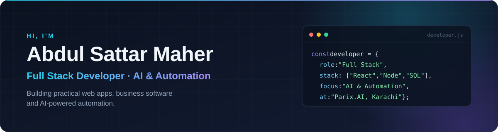

  

  
  
  
  

### About Me

I'm a **Full Stack Developer** and an **Information Technology graduate** from the *University of Sindh, Mirpurkhas Campus*. I build practical web applications, business software, and AI-powered automation, turning client requirements into working features and keeping existing apps running smoothly.

- 💼 &nbsp;Full Stack Developer at **Parix.AI**, Karachi, working on AI-powered products including **ActionMind AI**
- 🧩 &nbsp;Frontend to backend: responsive UIs, REST APIs, and SQL-backed business workflows
- 🤖 &nbsp;Integrating LLM APIs into real products, and using AI tools to ship and debug faster
- 🤝 &nbsp;Open to freelance projects and collaborations

### Tech Stack

<table>
  <tr>
    <td width="130"><b>Frontend</b></td>
    <td></td>
  </tr>
  <tr>
    <td><b>Backend</b></td>
    <td> &nbsp;<code>REST APIs</code></td>
  </tr>
  <tr>
    <td><b>Database</b></td>
    <td></td>
  </tr>
  <tr>
    <td><b>Tools</b></td>
    <td></td>
  </tr>
  <tr>
    <td><b>AI &amp; Other</b></td>
    <td> &nbsp;<code>LLM APIs (OpenRouter)</code> <code>AI Automation</code> <code>AI-Assisted Development</code></td>
  </tr>
</table>

### Featured Projects

<table>
  <tr>
    <td width="50%" valign="top">
      <h4><a href="https://github.com/Abdulsattar02/SmartTalkAI">🧠 SmartTalkAI</a></h4>
      
AI chatbot with a Tailwind CSS chat interface and an Express backend that connects to LLMs through OpenRouter.

      
<code>JavaScript</code> <code>Tailwind</code> <code>Node.js</code> <code>Express</code>

      <a href="https://smart-talk-ai-brown.vercel.app"><b>Live demo</b></a> · <a href="https://github.com/Abdulsattar02/SmartTalkAI">Source</a>
    </td>
    <td width="50%" valign="top">
      <h4><a href="https://github.com/Abdulsattar02/tehreem-fashionscape-e-commerce">👗 Tehreem FashionScape</a></h4>
      
Responsive fashion e-commerce storefront with cart and wishlist, plus an AI shopping-assistant chatbot.

      
<code>HTML</code> <code>CSS</code> <code>JavaScript</code> <code>Node.js</code> <code>Express</code>

      <a href="https://tehreem-fashionscape-e-commerce.vercel.app"><b>Live demo</b></a> · <a href="https://github.com/Abdulsattar02/tehreem-fashionscape-e-commerce">Source</a>
    </td>
  </tr>
  <tr>
    <td width="50%" valign="top">
      <h4><a href="https://github.com/Abdulsattar02/tereweb1">🌿 Tere — Ride-Sharing Website</a></h4>
      
Landing page for an eco-friendly ride-sharing app with fare and impact calculators, dark mode, English/Urdu/Sindhi switcher, and PWA offline support.

      
<code>HTML</code> <code>CSS</code> <code>JavaScript</code> <code>PWA</code>

      <a href="https://tereweb1.vercel.app"><b>Live demo</b></a> · <a href="https://github.com/Abdulsattar02/tereweb1">Source</a>
    </td>
    <td width="50%" valign="top">
      <h4><a href="https://github.com/Abdulsattar02/tehreem-perfume-store">🌸 Tehreem Perfume Store</a></h4>
      
Perfume storefront with product, cart, and checkout pages backed by a Node.js REST API for products, orders, and user auth.

      
<code>HTML</code> <code>CSS</code> <code>JavaScript</code> <code>Node.js</code> <code>Express</code>

      <a href="https://github.com/Abdulsattar02/tehreem-perfume-store">Source</a>
    </td>
  </tr>
  <tr>
    <td width="50%" valign="top">
      <h4>💼 Business Management Apps</h4>
      
Business software for inventory tracking, sales dashboards, and offline-first workflows.

      
<code>JavaScript</code> <code>SQL</code>

    </td>
    <td width="50%" valign="top">
      <h4><a href="https://github.com/Abdulsattar02/Tic-Tak-Toe">🎮 Tic-Tac-Toe</a></h4>
      
Classic Tic-Tac-Toe game that runs in the browser.

      
<code>HTML</code> <code>CSS</code> <code>JavaScript</code>

      <a href="https://tic-tak-toe-rouge.vercel.app"><b>Live demo</b></a> · <a href="https://github.com/Abdulsattar02/Tic-Tak-Toe">Source</a>
    </td>
  </tr>
</table>

**Also:** ✏️ Automatic Writing & Drawing Machine, an Arduino + web/AI capstone project

### GitHub Stats

  
  

### Connect

  
  
  
  
  
  
  

<i>Build. Learn. Improve. Repeat.</i>

